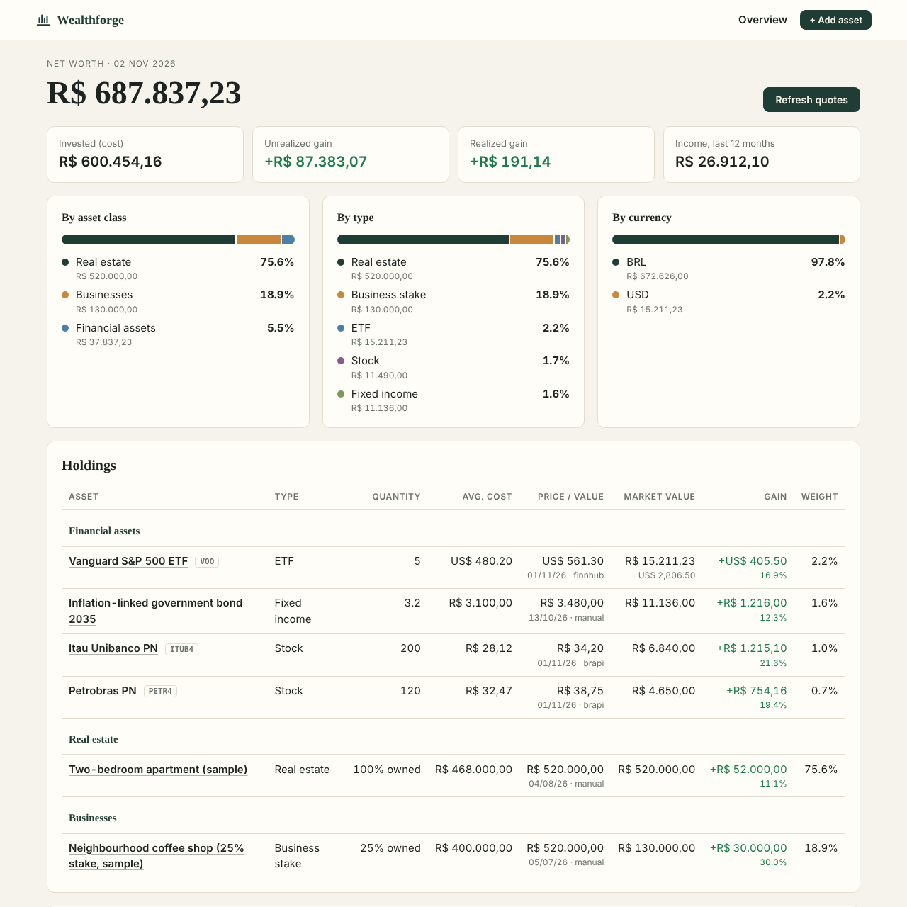

# Wealthforge

**Everything you own, in one place.** Wealthforge is a local-first organizer
for personal wealth: stocks, real estate funds, ETFs and bonds side by side with
the apartment you rent out and your stake in a friend's business. Prices of
listed assets update automatically; everything else you value yourself.

It runs on your own computer as a small web app. Your data stays in a single
SQLite file on your disk: no account, no cloud, no telemetry.


<sub>Screenshot with the built-in fictional demo portfolio.</sub>

## Who it is for

People in Brazil (or anywhere with a BRL base) whose wealth does not fit in one
broker app: B3 stocks and FIIs, some US ETFs, a property or two, and maybe a
share of a small company. Spreadsheets handle this badly because every asset
class is valued differently; Wealthforge uses one simple model for all of them.

## Features

- **Every asset class**: stocks, FIIs (REITs), ETFs, BDRs, fixed income, funds,
  crypto, cash, real estate and business stakes.
- **BRL and USD**: USD assets are converted with the official PTAX rate from
  the Banco Central do Brasil, fetched automatically (or typed in by hand).
- **Automatic quotes**: B3 assets from [brapi.dev](https://brapi.dev), US assets
  from [Finnhub](https://finnhub.io). One click on *Refresh quotes*.
- **Average cost and realized gains**: buys and sales with fees, using the
  average-cost method (preço médio) used in Brazil.
- **Real estate and businesses**: record what you own as a fraction (a half of
  a flat, 25% of a company) and value the whole asset from time to time.
- **Income**: dividends, JCP, rent, profit distributions and interest, with a
  last-12-months total.
- **Overview**: net worth, invested amount, gains, income and allocation by
  asset class, type and currency.
- **Exact arithmetic**: amounts are `Decimal` end to end, never floats, and
  numbers can be typed Brazilian-style (`1.234,56`) or US-style (`1,234.56`).

## How values work

Every holding is **quantity x unit price**:

| Asset            | Quantity                  | Unit price                     |
|------------------|---------------------------|--------------------------------|
| Stock, FII, ETF  | shares                    | price per share                |
| Fixed income     | units                     | unit value from your statement |
| Real estate      | fraction you own (1 = 100%) | value of the whole property  |
| Business stake   | fraction you own (0.25 = 25%) | value of 100% of the company |

So a 25% stake in a company worth R$ 520.000 is worth R$ 130.000, and the same
average-cost and gain calculations apply to every asset.

## Quick start

Requires Python 3.10 or newer.

**Windows (PowerShell)**

```powershell
git clone https://github.com/Tobiashopf/wealthforge.git
cd wealthforge
py -m venv .venv
.venv\Scripts\Activate.ps1
pip install -e .
wealthforge serve
```

**macOS / Linux**

```bash
git clone https://github.com/Tobiashopf/wealthforge.git
cd wealthforge
python3 -m venv .venv && source .venv/bin/activate
pip install -e .
wealthforge serve
```

`wealthforge serve` opens <http://127.0.0.1:8765> in your browser. The app only
listens on your own machine.

### Try it with fictional data

```bash
wealthforge demo --db demo.db
wealthforge serve --db demo.db
```

### API keys for automatic quotes

Both are optional and free. Copy `.env.example` to `.env` and fill in:

| Variable        | Used for                     | Without it                                    |
|-----------------|------------------------------|-----------------------------------------------|
| `BRAPI_TOKEN`   | B3 quotes (brapi.dev)        | only PETR4, MGLU3, VALE3 and ITUB4 are quoted |
| `FINNHUB_TOKEN` | US quotes (Finnhub)          | US assets need manual prices                  |

The USD/BRL rate needs no key. `.env` is in `.gitignore`; never commit it.

### Command line

| Command                  | What it does                                         |
|--------------------------|------------------------------------------------------|
| `wealthforge serve`      | start the web app (`--port`, `--no-browser`)          |
| `wealthforge refresh`    | update automatic prices and the USD/BRL rate          |
| `wealthforge summary`    | print holdings and net worth in the terminal          |
| `wealthforge demo`       | load the fictional sample portfolio into an empty DB  |

Every command accepts `--db PATH`. By default the database lives in
`%APPDATA%\wealthforge` on Windows and `~/.local/share/wealthforge` elsewhere,
or wherever `WEALTHFORGE_DB` points.

## Built with

Python 3.10+, [FastAPI](https://fastapi.tiangolo.com) with server-rendered
Jinja2 templates, SQLite (standard library), [httpx](https://www.python-httpx.org),
pytest and ruff. No JavaScript framework and no build step: the pages work
without JavaScript, and a few lines of vanilla JS add confirmations.

```
src/wealthforge/
  models.py      domain types (assets, trades, prices, income, FX rates)
  money.py       Decimal parsing and BRL/USD formatting
  db.py          SQLite schema and queries
  portfolio.py   average cost, valuation, allocation
  service.py     validation and use cases shared by the web app and the CLI
  quotes/        brapi.dev, Finnhub and Banco Central PTAX clients
  web/           FastAPI app, templates and CSS
  cli.py         command line
tests/           pytest suite; quote providers are tested with mocked HTTP
```

## Development

```bash
pip install -e ".[dev]"
pytest
ruff check . && ruff format --check .
```

CI runs the tests and linters on Linux and Windows with Python 3.10 and 3.13.
The test suite never touches the network.

## Roadmap

Net worth history, liabilities (mortgages), property costs and net yield,
rebalancing, CSV import/export, crypto and more currencies, automatic accrual of
CDI/IPCA-linked bonds and a Portuguese interface. See [ROADMAP.md](ROADMAP.md).

## Disclaimer

Wealthforge is a personal organizer, not investment, tax or legal advice.
Quotes come from third-party services and may be delayed or wrong; check
important numbers against your broker statements.

## License

[MIT](LICENSE) © 2026 Tobias Hopf de Souza
